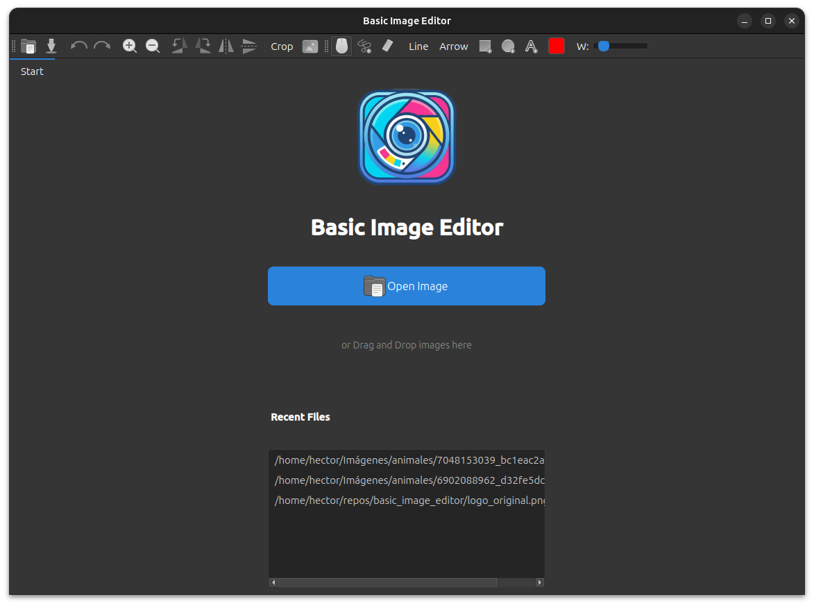
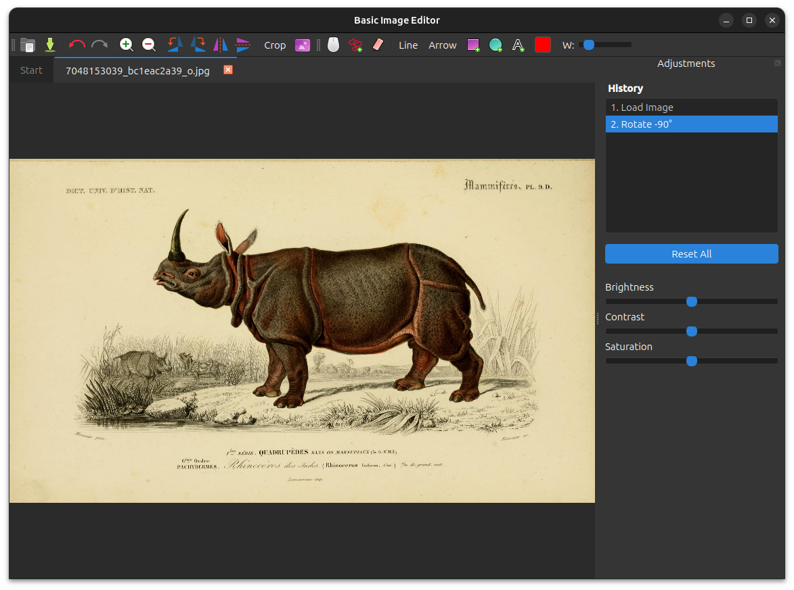

# Basic Image Editor

A minimalist, fast, and lightweight Desktop Image Editor application built with Python and PyQt6.

This project was born to have a simple editor that does the quick things I usually need. 
I don't want to use GIMP for simple tasks, nor do I aspire for this to be a GIMP replacement.

## Features

-   **Responsive Canvas & Multi-Tab Studio**: View and edit multiple photos simultaneously with multi-level Undo/Redo history.
-   **16-bit Camera RAW Developer**: Native support for `.ARW`, `.CR2`, `.CR3`, `.NEF`, `.DNG`, `.RAF`, `.ORF` with 256-entry SIMD/LUT curves for Exposure (EV), Shadows, Highlights, White Balance (Temp/Tint), Edge-Guided Denoise HD (zero grain), and Structural Sharpening HD.
-   **Curated Photographic Preset Gallery**: 7 built-in presets (`Electric Chroma HD`, `Moderna Definida HD`, `Editorial Viva HD`, `Kodachrome 64 Cine`, `Blanco y Negro Platino HD`, `CineStill 800T Halación`, `Desaturado Selectivo Platino`) with live miniature previews, continuous 0–100% intensity slider, and custom preset persistence.
-   **Smart Reveal Assistant**: Automatic histogram & scene analysis, 1-click Auto-Develop (`Ctrl+R`), Saliency-Guided 1:1 Square Crop for Instagram, and AI/C2PA Steganographic Watermark & Swirl Cleaner.
-   **100% Embedded Qwen AI Chat (`0.5B` / `1.5B`)**: In-process conversational chat agent powered by `llama-cpp-python` (`models/qwen2.5-0.5b-instruct.gguf` and `models/qwen2.5-1.5b-instruct.gguf`, automatically downloaded on first use if absent) + deterministic NLU engine to apply presets, tweak parameters, or create/save new custom presets via natural language with zero external daemons.
-   **Transformations, Annotations & AI Background Removal**: Rotate, flip, crop, vector shapes (pen, line, arrow, rect, circle, text), and asynchronous `rembg` background removal.
-   **Dark Theme**: Modern and clean user interface.

## Screenshots




## Installation and Usage

Clone the repository and run the provided script:

```bash
./run.sh
```

This script will automatically:
1.  Create a virtual environment (`venv`).
2.  Install the required dependencies from `requirements.txt`.
3.  Launch the application.

### Manual Installation

If you prefer to run it manually:

1.  Create a virtual environment:
    ```bash
    python3 -m venv venv
    source venv/bin/activate
    ```
2.  Install dependencies:
    ```bash
    pip install -r requirements.txt
    ```
3.  Run the application:
    ```bash
    python3 main.py
    ```

## Requirements

-   Python 3.10+
-   PyQt6
-   Pillow

## License

This project is licensed under the GPL-3.0-or-later License. See the [LICENSE](LICENSE) file for details.

---

> This application has been vibecoded using **Antigravity** in December - January 2026.

