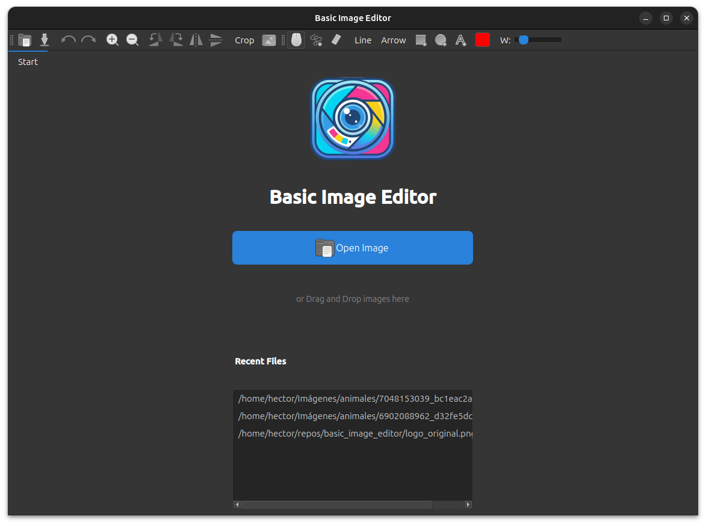
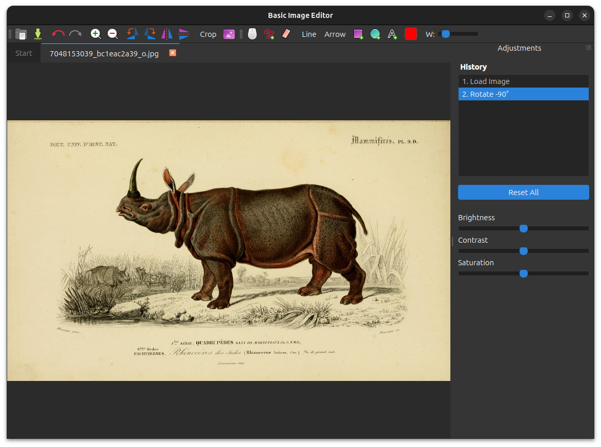

# Editor d'Imáxenes Básicu

Una aplicación d'escritoriu d'edición d'imáxenes minimalista, rápida y llixera, construyida con Python y PyQt6.

Esti proyeutu nació de la necesidá de tener un editor simple que faiga les coses rápides que suelo necesitar. Nun quiero usar GIMP pa xeres sencielles, nin aspiro a qu'esto sía un reemplazu de GIMP.

## Carauterístiques

* **Llenzu Adaptable y Estudiu Multi-Llingüeta**: Visualización y edición d'imáxenes con caché multinivel ya historial de Desfacer/Refacer.
* **Revelador RAW de 16 bits**: Soporte nativu pa `.ARW`, `.CR2`, `.CR3`, `.NEF`, `.DNG`, `.RAF`, `.ORF` con curves LUT SIMD de 256 entraes (Esposición EV, Sombres, Altes Lluces, Temperatura WB, Denoise HD ensin granu y Nitidez Estructural HD).
* **Galería de Presets Fotográficos HD**: 7 presets curaos con miniatures en direuto, deslizador d'intensidá 0–100% y creación de presets personalizaos.
* **Asistente Intelixente de Reveláu**: Diagnósticu automáticu d'escena, Auto-Reveláu n'1 clic (`Ctrl+R`), Encuadre Intelixente 1:1 pa Instagram y Llimpiador de marques d'agua IA / C2PA.
* **Chat IA Conversacional 100% Integráu con Qwen (`0.5B` / `1.5B`)**: Axente executáu direutamente en procesu con `llama-cpp-python` y modelos GGUF integraos (`models/qwen2.5-0.5b-instruct.gguf` y `models/qwen2.5-1.5b-instruct.gguf`) ensin precisar d'Ollama nin servicios esternos p'aplicar presets, camudar axustes o guardar presets nuevos falando en llingua natural.
* **Tresformamientos, Dibuxu Vectorial y Desaniciu de Fondu IA**: Xirar, voltiar, recortar, anotar y desaniciar el fondu con `rembg`.
* **Tema Escuru**: Interfaz d'usuariu moderna y llimpia.

## Captures de Pantalla




## Instalación y Usu

Clona'l repositoriu y executa'l script apurríu:

```bash
./run.sh

```

Esti script automáticamente:

1. Creará una redolada virtual (`venv`).
2. Instalará les dependencies necesaries dende `requirements.txt`.
3. Arrancará l'aplicación.

### Instalación Manual

Si prefieres executalu manualmente:

1. Crea una redolada virtual:
```bash
python3 -m venv venv
source venv/bin/activate

```


2. Instala les dependencies:
```bash
pip install -r requirements.txt

```


3. Executa l'aplicación:
```bash
python3 main.py

```


## Requisitos

* Python 3.10+
* PyQt6
* Pillow

## Llicencia

Esti proyeutu ta llicenciáu baxo la Llicencia GPL-3.0-o-posterior. Consulta l'archivu [LICENSE](https://www.google.com/search?q=LICENSE) pa más detalles.

---

> Esta aplicación foi vibecodeada usando **Antigravity** n'Avientu - Xineru de 2026.
