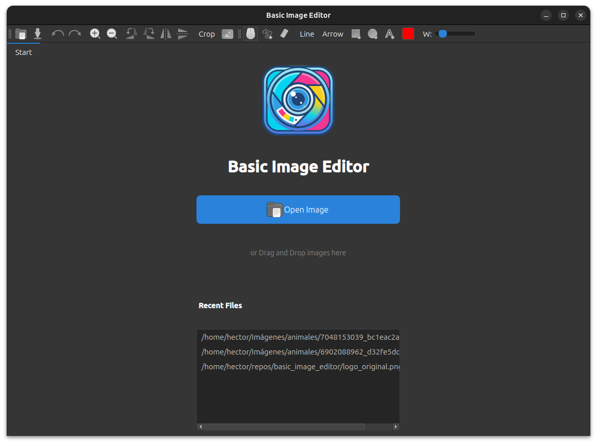
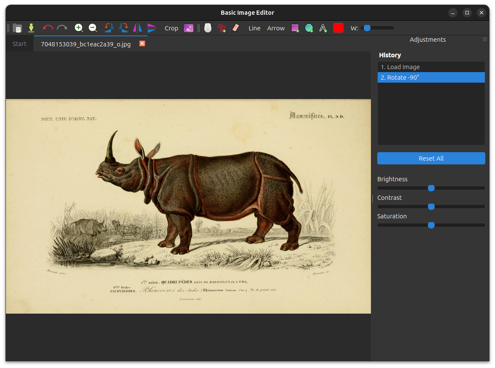

# Editor de Imágenes Básico

Una aplicación de escritorio de edición de imágenes minimalista, rápida y ligera, construida con Python y PyQt6.

Este proyecto nació de la necesidad de tener un editor simple que haga las cosas rápidas que suelo necesitar. No quiero usar GIMP para tareas sencillas, ni aspiro a que esto sea un reemplazo de GIMP.

## Características

-   **Lienzo Responsivo**: visualización y edición de imágenes.
-   **Operaciones de Archivo**: Abrir y guardar imágenes.
-   **Transformaciones**: Rotar y voltear imágenes.
-   **Herramienta de Recorte**: Funcionalidad de recorte fácil de usar.
-   **Ajustes**: Controles de brillo, contraste y saturación.
-   **Tema Oscuro**: Interfaz de usuario moderna y limpia.

## Capturas de Pantalla




## Instalación y Uso

Clona el repositorio y ejecuta el script proporcionado:

```bash
./run.sh
```

Este script automáticamente:
1.  Creará un entorno virtual (`venv`).
2.  Instalará las dependencias necesarias desde `requirements.txt`.
3.  Iniciará la aplicación.

### Instalación Manual

Si prefieres ejecutarlo manualmente:

1.  Crea un entorno virtual:
    ```bash
    python3 -m venv venv
    source venv/bin/activate
    ```
2.  Instala las dependencias:
    ```bash
    pip install -r requirements.txt
    ```
3.  Ejecuta la aplicación:
    ```bash
    python3 main.py
    ```

## Requisitos

-   Python 3.10+
-   PyQt6
-   Pillow

## Licencia

Este proyecto está licenciado bajo la Licencia GPL-3.0-o-posterior. Consulta el archivo [LICENSE](LICENSE) para más detalles.

---

> Esta aplicación ha sido vibecodeada usando **Antigravity** en Diciembre - Enero de 2026.

